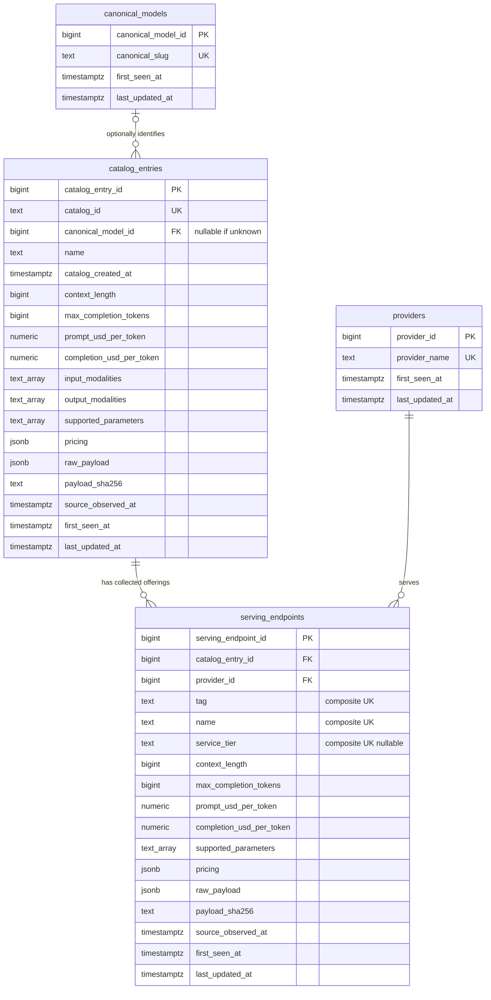

# DRAFT / FOR REVIEW: Relational schema

Assistant-prepared November 7, 2026, with cloud-status clarification November 13. Start with [the pre-SQL design](milestone2_design_plan.md). Implementation: [`db/schema.sql`](../db/schema.sql), PostgreSQL **15+** (`NULLS NOT DISTINCT` is required). Historical local testing and the actual November 12 Supabase Session-pooler execution both used PostgreSQL 17.11; see [cloud verification](milestone2_cloud_verification.json). The Mermaid block below is the repository ER diagram required by assignment 3.2.

`text_array` denotes SQL `text[]`. Endpoint composite uniqueness includes **both FKs plus tag, name and service_tier**, with NULLS NOT DISTINCT. The diagram's UK annotations on routing columns describe this combined key, not separate unique columns.

## What one row means

- **canonical_models:** one exact nonempty source `canonical_slug`, with a generated PK and natural-ID UNIQUE constraint. It groups returned identities, not verified distinct architectures; the November 7 run contains 616 such slugs.
- **catalog_entries:** one exact request/catalog `id`, including an alias or variant. Its optional FK points to its returned canonical identity; the actual main-table load contains 705 rows, not 705 distinct architectures.
- **providers:** one exact serving `provider_name` actually returned in the endpoint sample (9 rows). Provider names are provisional identifiers, not inferred model authors, and name changes would create a new provider.
- **serving_endpoints:** one observed offering for a catalog entry and serving provider, distinguished further by tag, name and service tier (19 rows). A missing endpoint row generally means **not collected** here, not unavailable globally.

These are genuine data entities. There are no fabricated task, user, organization or benchmark rows added to reach the three-table requirement.

## Constraints, types and unknown values

Every table has a generated `bigint` PK, UNIQUE source identity (or provisional endpoint composite), and NOT NULL timezone-aware audit columns. All three relationships have FKs with default restrictive deletion behavior. Natural identifiers are retained verbatim; invalid IDs are rejected, not trimmed or repaired.

Context/output limits are nullable nonnegative `bigint`; zero is retained when the source explicitly reports zero and does not prove useful capacity. Token rates use unconstrained-precision `numeric`, constrained to finite nonnegative values. Missing fields remain NULL, not zero. Negative source prices (eight catalog rows in this run) remain in `raw_payload`/`pricing`, but usable typed token rates become NULL. The observed `-1` values are not interpreted as a discount or a verified credit. Malformed prices, integer booleans, bad ranges and malformed arrays/objects are rejected before writes.

`pricing` retains the complete pricing object, including non-token units, cache fields and overrides. `raw_payload` retains the full original parsed record as JSONB; it is not a byte-identical copy of the HTTP body. `payload_sha256` hashes sorted, compact UTF-8 JSON with `ensure_ascii=False`; exact HTTP response byte hashes are separately retained in the local public-source manifest.

`catalog_created_at` converts source Unix seconds to timestamptz and means **added to OpenRouter**, not model release or price-update time. `source_observed_at` is the complete fetch's `finished_at` label (individual responses occurred earlier during that run). `first_seen_at` is database insertion time, not source creation; `last_updated_at` initially equals it. Insert-only replay preserves both. An audit-order CHECK prevents last_updated_at preceding first_seen_at.

## Debated design choice: proposal, not student decision

A simpler alternative was one canonical-model table with aliases collapsed. The proposed design keeps **canonical identity separate from catalog entry**: distinct request IDs may have different variants, prices and capabilities, while endpoint `model_id` joins to catalog IDs. Collapsing those rows would hide 89 shared-identity groups measured in this run. This rationale is assistant analysis, not a claim that DJ rejected a suggestion.

The endpoint API supplies no universal endpoint ID in the inspected sample. A generated PK plus `(catalog_entry_id, provider_id, tag, name, service_tier)` UNIQUE NULLS NOT DISTINCT preserves distinct Azure regional routes and makes nullable tiers replay-safe. NULL and empty text are not merged. This key's long-term stability remains unproven, and renamed providers/endpoints need a future reconciliation policy.

## Load lifecycle and limits

1. Validate a complete fetch summary, minimum unique IDs, typed fields and all parent references before writes.
2. In one transaction insert canonical parents, catalog entries, provider parents, then endpoints. Bind every source value through psycopg `%s` parameters and JSONB adapters.
3. `ON CONFLICT DO NOTHING` makes replay duplicate-free. Returned counts are **total stored rows**, not newly inserted counts; generated sequences may advance on conflicts even though stored rows/audits do not change.
4. A late PostgreSQL trigger failure test proves all parent/earlier-child writes roll back. Constraints are exercised in actual PostgreSQL, not merely inspected as strings.

This milestone deliberately does **not** update changed payloads for an existing key, track deletions, claim an exact current snapshot after loading multiple runs, implement concurrency scheduling, or grant public API/app roles. `last_updated_at` will need honest change detection in Milestone 3. Schema application is one-time to a new trusted schema, never a destructive migration. Supabase setup and actual loader/query verification were completed in the dated continuations recorded in [the AI review log](milestone2_ai_review.md). Data API OFF was observed during setup; no new setting change or cloud app-role hardening is claimed by publishing this document.
