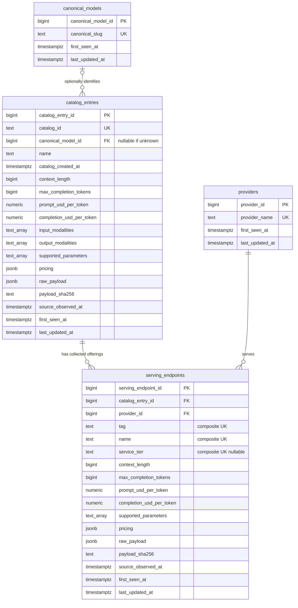

# DRAFT / FOR REVIEW: Relational schema

Assistant-prepared November 7, 2026, with cloud-status clarification November 13. Start with [the pre-SQL design](milestone2_design_plan.md). Implementation: [`db/schema.sql`](../db/schema.sql), PostgreSQL **15+** (`NULLS NOT DISTINCT` is required). Historical local testing and the actual November 12 Supabase Session-pooler execution both used PostgreSQL 17.11; see [cloud verification](milestone2_cloud_verification.json). The Mermaid block below is the repository ER diagram required by assignment 3.2.



`text_array` denotes SQL `text[]`. Endpoint composite uniqueness includes **both FKs plus tag, name and service_tier**, with NULLS NOT DISTINCT. The diagram's UK annotations on routing columns describe this combined key, not separate unique columns.

## What one row means

- **canonical_models:** one exact nonempty source `canonical_slug`, with a generated PK and natural-ID UNIQUE constraint. It groups returned identities, not verified distinct architectures; the November 7 run contains 616 such slugs.
- **catalog_entries:** one exact request/catalog `id`, including an alias or variant. Its optional FK points to its returned canonical identity; the actual main-table load contains 705 rows, not 705 distinct architectures.
- **providers:** one exact serving `provider_name` actually returned in the endpoint sample (9 rows). Provider names are provisional identifiers, not inferred model authors, and name changes would create a new provider.
- **serving_endpoints:** one observed offering for a catalog entry and serving provider, distinguished further by tag, name and service tier (19 rows). A missing endpoint row generally means **not collected** here, not unavailable globally.

These are genuine data entities. There are no fabricated task, user, organization or benchmark rows added to reach the three-table requirement.

## Constraints, types and unknown values

Every table has a generated `bigint` PK, UNIQUE source identity (or provisional endpoint composite), and NOT NULL timezone-aware audit columns. All three relationships have FKs with default restrictive deletion behavior. Natural identifiers are retained verbatim; invalid IDs are rejected, not trimmed or repaired.

Context/output limits are nullable nonnegative `bigint`; zero is retained when the source explicitly reports zero and does not prove useful capacity. Token rates use unconstrained-precision `numeric`, constrained to finite nonnegative values. Missing fields remain NULL, not zero. Negative source prices (eight catalog rows in this run) remain in `raw_payload`/`pricing`, but usable typed token rates become NULL. The observed `-1` values are not interpreted as a discount or a verified credit. Malformed prices, integer booleans, bad ranges and malformed arrays/objects are rejected before writes.

`pricing` retains the complete pricing object, including non-token units, cache fields and overrides. `raw_payload` retains the full original parsed record as JSONB; it is not a byte-identical copy of the HTTP body. `payload_sha256` hashes sorted, compact UTF-8 JSON with `ensure_ascii=False`; exact HTTP response byte hashes are separately retained in the local public-source manifest.

`catalog_created_at` converts source Unix seconds to timestamptz and means **added to OpenRouter**, not model release or price-update time. `source_observed_at` is the complete fetch's `finished_at` label (individual responses occurred earlier during that run). `first_seen_at` is database insertion time, not source creation; `last_updated_at` initially equals it. Insert-only replay preserves both. An audit-order CHECK prevents last_updated_at preceding first_seen_at.

## Debated design choice: proposal, not student decision

A simpler alternative was one canonical-model table with aliases collapsed. The proposed design keeps **canonical identity separate from catalog entry**: distinct request IDs may have different variants, prices and capabilities, while endpoint `model_id` joins to catalog IDs. Collapsing those rows would hide 89 shared-identity groups measured in this run. This rationale is assistant analysis, not a claim that DJ rejected a suggestion.

The endpoint API supplies no universal endpoint ID in the inspected sample. A generated PK plus `(catalog_entry_id, provider_id, tag, name, service_tier)` UNIQUE NULLS NOT DISTINCT preserves distinct Azure regional routes and makes nullable tiers replay-safe. NULL and empty text are not merged. This key's long-term stability remains unproven, and renamed providers/endpoints need a future reconciliation policy.

## Load lifecycle and limits

1. Validate a complete fetch summary, minimum unique IDs, typed fields and all parent references before writes.
2. In one transaction insert canonical parents, catalog entries, provider parents, then endpoints. Bind every source value through psycopg `%s` parameters and JSONB adapters.
3. `ON CONFLICT DO NOTHING` makes replay duplicate-free. Returned counts are **total stored rows**, not newly inserted counts; generated sequences may advance on conflicts even though stored rows/audits do not change.
4. A late PostgreSQL trigger failure test proves all parent/earlier-child writes roll back. Constraints are exercised in actual PostgreSQL, not merely inspected as strings.

This milestone deliberately does **not** update changed payloads for an existing key, track deletions, claim an exact current snapshot after loading multiple runs, implement concurrency scheduling, or grant public API/app roles. `last_updated_at` will need honest change detection in Milestone 3. Schema application is one-time to a new trusted schema, never a destructive migration. Supabase setup and actual loader/query verification were completed in the dated continuations recorded in [the AI review log](milestone2_ai_review.md). Data API OFF was observed during setup; no new setting change or cloud app-role hardening is claimed by publishing this document.

## Milestone 3 extension

DRAFT / FOR REVIEW, reconciled November 14, 2026. The preceding M2 section is now the exact final published M2 schema documentation, including its dated cloud-status clarification. Its insert-only lifecycle is superseded for M3 by ingest/sync.py, not by relabeling the M2 loader as a sync. The loader is the exact final published M2 implementation; schema SQL is unchanged. As of that November 14 reconciliation, only local access had been demonstrated. The later Access roles entry below records the live migration and login.

`db/milestone3.sql` adds durable `sync_runs` and owner-only `sync_state`. The checkpoint is a full-snapshot observation/hash, not an invented modification watermark. Successful upserts, checkpoint advance and terminal success commit together. A session advisory lock serializes this sync implementation; do not concurrently run the old loader or another writer that ignores the lock. Absent/unselected records remain last-known observations, not a certified current inventory.

## Access roles

### Live Supabase Session pooler — November 22, 2026 (Central)

The migration added `sync_runs` and `sync_state`. Immediately before and after migration, counts **and checksums** matched for all four existing catalog tables (616 canonical models, 705 catalog entries, 9 providers, 19 endpoints); `sync_runs` was empty. The later [manual sync](sync_tests.md#live-manual-sync-and-recovery) changed those counts. The grant check showed SELECT with no write grants on those four tables and `sync_runs`, and neither SELECT nor write on `sync_state`. Sources: `pre-migration.json`, `migration-verified.json`, `manual-sync-retry-readback.json`.

The earlier owner-session `SET ROLE` attempt was denied. That was not a test of what a connected reader could do. At **2026-11-23 03:50:33 UTC** (November 22, 9:50 p.m. Central), a separate Session-pooler login used full TLS verification; both `session_user` and `current_user` were `app_reader`. Recorded command and output (`live-app-reader-proof.json`):

```text
$ python scripts/check_db.py --app
[ok] Connected using APP_DATABASE_URL
     Database user: app_reader
     Server: PostgreSQL 17.11 on aarch64-unknown-linux-gnu
```

The following SQL ran as that reader. The two write probes used read-write transactions and selected no rows, so their `42501` errors demonstrate table permissions, not a transaction set to read-only. No catalog row was modified.

```sql
SELECT count(*) FROM public.catalog_entries;
-- 773

DELETE FROM public.catalog_entries WHERE false;
-- ERROR: permission denied for table catalog_entries (SQLSTATE 42501)

INSERT INTO public.catalog_entries (catalog_entry_id) OVERRIDING SYSTEM VALUE SELECT catalog_entry_id FROM public.catalog_entries WHERE false;
-- ERROR: permission denied for table catalog_entries (SQLSTATE 42501)
```

**Data API:** the SQL marker was absent; that does not reveal whether the dashboard toggle was on or off. The November 12 setup observation is historical, not current verification. The separate [reader reference baseline](sync_tests.md#live-reference-baseline) was recorded later than these permission probes.

### Historical local access proof — November 13, 2026

Local proof timestamp: `2026-11-13T00:17:48.935877+00:00`. Actual distinct local app_reader, synthetic data, PostgreSQL 17.11, local Unix-socket trust authentication. This does not prove Supabase password or Session pooler authentication. These SQL commands and primary error messages come from `../../evidence/pre-fix/access-role-proof.json`:

```sql
SELECT current_user;
-- app_reader
SELECT count(*) FROM public.catalog_entries;
-- 4
DELETE FROM public.catalog_entries;
-- ERROR: permission denied for table catalog_entries
-- SQLSTATE: 42501
INSERT INTO public.catalog_entries DEFAULT VALUES;
-- ERROR: permission denied for table catalog_entries
-- SQLSTATE: 42501
```

The actual CLI `python -I -B scripts/check_db.py --app` also reported `Database user: app_reader`; output is in `../../evidence/pre-fix/acceptance-current-local/acceptance.json`. Integration tests repeated SELECT, INSERT-denial and DELETE-denial across all four data tables and sync_runs, denied reading sync_state, and denied schema CREATE. `db/roles.sql` grants SELECT on the exact four tables plus sync_runs, with no password in the file. It rejects elevated or role-member existing app_reader identities and inherited PUBLIC write/CREATE privileges. Ordinary PostgreSQL catalog metadata visibility does not grant application mutation rights. Existing cloud ACLs and security-definer functions still need target-specific owner review.

November 13 handoff (historical): after review, privately set the role password and APP_DATABASE_URL using Session pooler user form `app_reader.<project-ref>`. Never put a password or connection value in this document, SQL or a workflow. The sync uses DATABASE_URL; status/quality/golden readers use APP_DATABASE_URL and reject an owner connection. No cloud reader provisioning or live M3 permission proof occurred in that local run.

Data API off remains an independent target-verification gate for this draft. Local PostgreSQL cannot prove a Supabase dashboard setting. Do not enable a disabled API or change unrelated roles to bypass an inspection failure. Follow `review_gate.md` before any cloud operation or publication.


## Assistant-only hardened v2 update

The earlier dated local measurements remain historical pre-fix evidence. Review found and actual disposable PostgreSQL tests reproduced a table-owner DROP bypass, surviving PUBLIC column UPDATE, and a committed-success audit overwritten after interruption. Independent synthetic probes also exposed stale/reused question-origin mappings. The hardened code adds fail-closed ownership/column checks, preserves terminal audit results and requires exact distinct original questions. Authoritative RED/GREEN pairs and the 67-test full/60-test A-D receipts are in the packet `parent-review/fix-cycle-1/`. Preliminary failed harness attempts are explicitly superseded in `fix-summary.json`; they are not product GREENs. Parent final acceptance/re-review is separate. None of this supplies student history, personal predictions, understanding, decisions, recordings, cloud proof or schedule evidence.

## November 14, 2026 reconciled local access proof

Actual fresh isolated PostgreSQL proof, not Supabase Session-pooler/Data API evidence. Receipt: `../../evidence/preseal-full/cli-acceptance/acceptance.json`. The role file is still the hardened M3v2 file.

| SQL | Actual result / SQLSTATE |
|---|---|
| SELECT count(*) FROM canonical_models | [[0]] |
| DELETE FROM canonical_models | permission denied / 42501 |
| INSERT INTO canonical_models DEFAULT VALUES | permission denied / 42501 |
| SELECT count(*) FROM catalog_entries | [[0]] |
| DELETE FROM catalog_entries | permission denied / 42501 |
| INSERT INTO catalog_entries DEFAULT VALUES | permission denied / 42501 |
| SELECT count(*) FROM providers | [[0]] |
| DELETE FROM providers | permission denied / 42501 |
| INSERT INTO providers DEFAULT VALUES | permission denied / 42501 |
| SELECT count(*) FROM serving_endpoints | [[0]] |
| DELETE FROM serving_endpoints | permission denied / 42501 |
| INSERT INTO serving_endpoints DEFAULT VALUES | permission denied / 42501 |
| SELECT count(*) FROM sync_runs | [[0]] |
| DELETE FROM sync_runs | permission denied / 42501 |
| INSERT INTO sync_runs DEFAULT VALUES | permission denied / 42501 |

As of November 14, cloud app_reader/password/pooler/TLS/Data API-off and live outputs were pending approved activation. The later Access roles entry documents what was subsequently verified.
